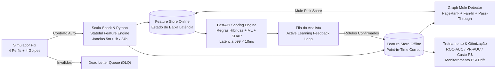

# 🚨 NovaBank Pix Fraud Radar — Real-Time Streaming ML & Graph Analytics

Plataforma de **Machine Learning Engineering, Engenharia de Dados em Streaming (Scala Spark + Python) e Análise de Grafos** para prevenção a fraudes Pix em tempo real (`p99 < 10 ms`) no **NovaBank**.

---

## 🏗️ Arquitetura em Tempo Real



---

## ✨ Destaques Técnicos

1. **Simulador Pix com 4 Tipologias Reais de Golpe (`src/pix_fraud_radar/simulator.py`)**:
   - **Golpe do Falso Parente**: chave Pix criada há $\le 2$ dias, valor $6\times$ a $14\times$ acima da média do cliente, horário noturno/madrugada.
   - **Invasão de Conta (ATO — Account Takeover)**: dispositivo não reconhecido + redefinição recente de senha ($\le 30$ min) + drenagem de saldo ($\ge 85\%$).
   - **Rede de Contas Laranja (Money Mule Ring)**: topologia *Fan-In* de vítimas para contas laranja (`MULE_001..006`) seguida de *Pass-Through* para conta centralizadora (`MULE_BOSS_001`).
   - **Smurfing / Estruturação**: rajada de 5 transferências seguidas entre R$ 960 e R$ 998 em menos de 3 minutos.
2. **Feature Engineering Stateful em Scala Spark & Python (`scala/streaming-features/` e `src/pix_fraud_radar/streaming_features.py`)**:
   - Uso de `flatMapGroupsWithState` com Watermark no Scala Spark e janelas móveis de 5 min, 1h e 24h com garantia estrita de **Point-in-Time Correctness** (zero *data leakage*).
3. **Detecção de Contas Laranja por Grafos (`src/pix_fraud_radar/graph_mule_detector.py`)**:
   - Algoritmo de **PageRank iterativo** combinado com métricas de *In-Degree* (pagadores únicos) e *Pass-Through Ratio* (taxa de escoamento).
4. **MLOps, Otimização Financeira de Threshold, SHAP & PSI Drift (`src/pix_fraud_radar/ml_engine.py`)**:
   - Otimiza o limiar de corte maximizando a **Economia Líquida em R$** (`Fraudes Evitadas - Custo de Falsos Positivos`).
   - Decomposição aditiva (estilo **SHAP**) retornando os 3 principais fatores de risco de cada transação.
   - Cálculo de **PSI (Population Stability Index)** para detecção automática de *feature drift* e *prediction drift*.
5. **Fila de Investigação do Analista & Active Learning (`src/pix_fraud_radar/rules_engine.py`)**:
   - Casos suspeitos vão para revisão (`STEP_UP_REVIEW` ou `BLOCK`) e podem ser rotulados (`CONFIRMED_FRAUD` / `FALSE_POSITIVE`) via API para retreino do modelo.

---

## 🚀 Como Executar e Testar

```bash
pip install -e ".[dev]" fastapi uvicorn httpx
PYTHONPATH=src pytest -v
```

### Subir a API de Scoring em Tempo Real e o Dashboard
```bash
PYTHONPATH=src uvicorn pix_fraud_radar.api.app:app --reload --port 8000
```
- **Dashboard em Tempo Real**: `http://localhost:8000/dashboard`
- **Swagger OpenAPI**: `http://localhost:8000/docs`
- **Scoring Síncrono (< 10ms)**: `POST /api/v1/pix/score`
- **Ranking de Contas Laranja (PageRank)**: `GET /api/v1/graph/mules`
